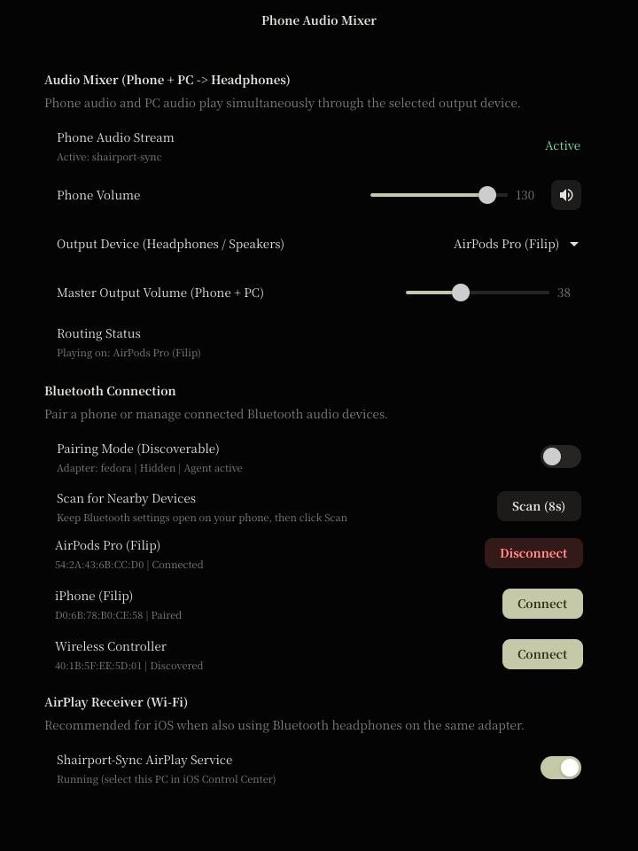

# Phone Audio Mixer

A lightweight, native GTK4 / Libadwaita application for Linux that lets you stream audio from your phone (Android or iPhone) to your PC over **Bluetooth (A2DP)** or **AirPlay (Wi-Fi)** and mix it seamlessly with your PC audio into any connected headphones or speakers.



## Features

- **Simultaneous Audio Mixing**: Play audio from your phone and your PC at the same time on the same headphones or speakers via PipeWire / PulseAudio.
- **Independent Volume Controls**: Separate volume slider (0-150%) and mute toggle for the incoming phone stream, plus a master volume slider for the selected output device.
- **Built-in Bluetooth Pairing Agent**: Registers `org.bluez.Agent1` directly on the system D-Bus (with an in-app confirmation dialog and automatic device trusting), so pairing works reliably even on minimal window managers such as Hyprland, Sway, or i3 without a desktop environment applet.
- **Direct BlueZ D-Bus Integration**: Queries adapters and devices directly via `org.freedesktop.DBus.ObjectManager` without spawning CLI processes in the background, and automatically re-registers the pairing agent if `bluetoothd` restarts.
- **Universal Stream Routing**: Supports both PipeWire `sink-input` streams (`bluez_input.*`, `shairport-sync`, `uxplay`) and PulseAudio/WirePlumber `Audio/Source` nodes (with automatic `module-loopback` routing).
- **AirPlay (Wi-Fi) Support**: Detects and controls `shairport-sync.service` (`systemd --user`), allowing iOS devices to stream lossless/AAC audio over Wi-Fi when your Bluetooth adapter is already busy driving Bluetooth headphones.
- **Dual-A2DP Contention Detection**: Warns automatically when both an incoming Bluetooth phone stream and outgoing Bluetooth headphones share a single Bluetooth adapter.

## Requirements

- Linux with **PipeWire** (`pipewire-pulse`) or **PulseAudio** (`pactl`)
- **BlueZ** (`bluetoothd`)
- **Python 3.10+** with **PyGObject**, **GTK 4**, and **Libadwaita**
- Optional: **shairport-sync** + **avahi-daemon** for AirPlay over Wi-Fi

### Installing Dependencies

**Fedora:**
```bash
sudo dnf install python3-gobject gtk4 libadwaita bluez pipewire-pulseaudio
# Optional for Wi-Fi AirPlay:
sudo dnf install shairport-sync avahi
```

**Arch Linux:**
```bash
sudo pacman -S python-gobject gtk4 libadwaita bluez pipewire-pulse
# Optional for Wi-Fi AirPlay:
sudo pacman -S shairport-sync avahi
```

**Ubuntu / Debian:**
```bash
sudo apt install python3-gi gir1.2-gtk-4.0 gir1.2-adw-1 bluez pulseaudio-utils
# Optional for Wi-Fi AirPlay:
sudo apt install shairport-sync avahi-daemon
```

## Installation

```bash
git clone https://github.com/filipboski1313-a11y/phone-audio-mixer.git
cd phone-audio-mixer
./install.sh
```

This installs `phone-audio-mixer` (and a `bt-audio-mixer` symlink) to `~/.local/bin/` and adds a desktop entry to `~/.local/share/applications/`.

## Usage

Launch **Phone Audio Mixer** from your application launcher or run:

```bash
phone-audio-mixer
```

### Option A: Bluetooth (Android / iOS)

1. Enable **Pairing Mode (Discoverable)** in the app.
2. Connect to your PC from your phone's Bluetooth settings, or open Bluetooth settings on your phone and click **Scan (8s)** in the app to initiate pairing from the PC.
3. Accept the 6-digit pairing confirmation dialog.
4. Play audio on your phone and select your preferred headphones under **Output Device**.

### Option B: AirPlay over Wi-Fi (Recommended for iOS + Bluetooth Headphones)

If you use Bluetooth headphones on your PC and want to stream from an iPhone at the same time, using AirPlay over Wi-Fi avoids sharing a single Bluetooth radio between two A2DP streams:

1. Configure `shairport-sync` with `output_backend = "pw";` (PipeWire) as a `systemd --user` service.
2. Enable **Shairport-Sync AirPlay Service** in the app.
3. Open **Control Center** on your iPhone, tap the audio output icon, and choose your PC.

## License

[MIT](LICENSE)
